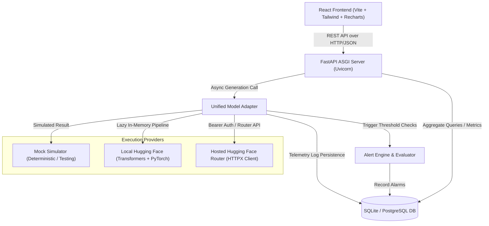

# Architecture Overview: GenAI Deployment & Monitoring Dashboard

This document details the software architecture, data lifecycle, telemetry engine, and security boundaries of the **Generative AI Model Deployment and Monitoring Dashboard**.

---

## 1. High-Level Architecture Diagram

---

## 2. Core Components

### 2.1 Unified Model Adapter (`app/services/model_adapter.py`)
Provides a single interface for executing inference regardless of provider:
- **High-Resolution Clock**: Uses `time.perf_counter()` to record accurate latency in milliseconds.
- **Error Sanitization**: Intercepts exceptions, stripping API tokens and internal credentials so they never leak into logs or client responses.
- **Guaranteed Persistence**: Every request (both successful responses and catastrophic failures) is saved to the database.

### 2.2 Providers
- **Mock Provider (`app/services/mock_provider.py`)**: Realistic responses marked with `[MOCK / SIMULATION]`. Zero cloud costs or memory footprint.
- **Local Provider (`app/services/local_provider.py`)**: Lazy-loaded in-memory pipeline cache avoiding repeated model reloading. Automatic device discovery (`cuda` vs `cpu`).
- **Hosted Provider (`app/services/hosted_provider.py`)**: HTTPX client targeting Hugging Face Router. Handles 503 model-loading backoff retries, 401 authentication errors, and rate limits without runaway duplicate calls.

### 2.3 Telemetry & Metrics Service (`app/services/metrics_service.py`)
Computes operational statistics from real recorded requests:
- **P95 Latency**: Standard 95th percentile computed using exact sorted position interpolation.
- **Success & Error Rates**: `(successful / total) * 100` and `(failed / total) * 100`.
- **Requests Per Minute**: Rolling 60-minute window count / 60.
- **Cost Estimation**: Ballpark $0.0002 / 1k tokens for hosted serverless inference.

### 2.4 Alert Engine (`app/services/alert_service.py`)
Monitors operational health thresholds:
- **Rolling Error Rate**: Alerts if error rate > 10.0% in recent requests.
- **Consecutive Failures**: Alerts if 3 consecutive requests fail.
- **P95 Latency Spikes**: Alerts if P95 latency > 2,500ms.
- **Deduplication**: Retains existing active alerts to avoid notification floods.
